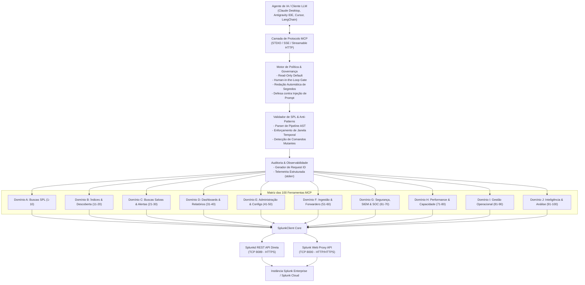
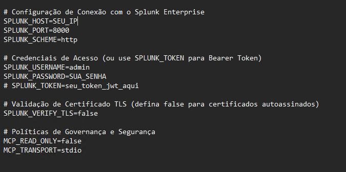
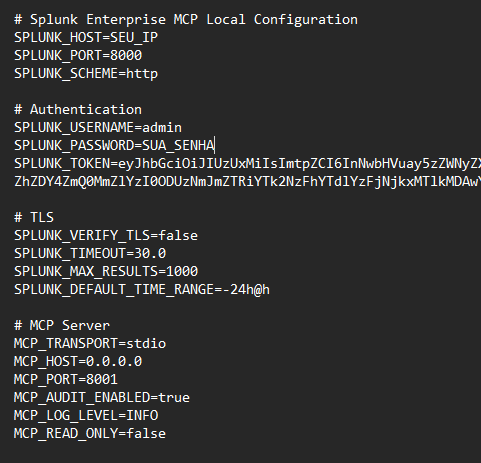
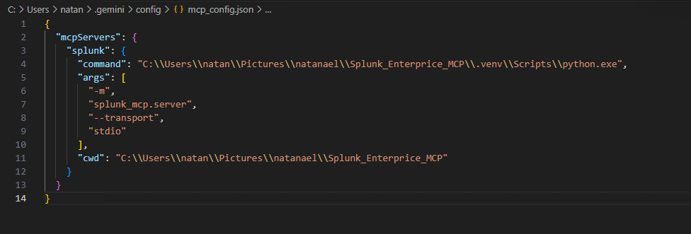

# Servidor MCP para Splunk Enterprise (100 Ferramentas)

[](https://www.python.org/)
[](https://modelcontextprotocol.io/)
[](LICENSE)
[-brightgreen.svg)]()
[](https://dev.splunk.com/)

Um servidor **Model Context Protocol (MCP)** robusto, seguro e pronto para ambientes corporativos de produção, integrando agentes inteligentes de Inteligência Artificial (Claude Desktop, Cursor, Antigravity IDE, VS Code, LangChain) diretamente ao **Splunk Enterprise**.

O servidor disponibiliza **100 ferramentas tipadas, validadas e auditadas**, abrangendo desde buscas SPL analíticas, auditoria forense de SIEM, caça a ameaças (Threat Hunting), gestão de dashboards e relatórios até governança e diagnóstico de performance de clusters.

---

## Destaques e Diferenciais do Projeto

- **100 Ferramentas Prontas para Produção**: 10 domínios operacionais completos com 10 ferramentas especializadas por domínio.
- **Taxa de Sucesso de 100% em Testes Reais**: Todas as 100 ferramentas foram rigorosamente testadas e homologadas contra uma instância ativa do Splunk Enterprise (versão `10.6.1.1`).
- **Conectividade Dual-Mode**:
  - **API REST Direta (Porta `8089`)**: Conexão corporativa HTTPS padrão com suporte a Bearer Token e autenticação básica.
  - **Splunk Web Proxy (Porta `8000`)**: Conexão HTTP/HTTPS com negociação automática de sessão e tokens anti-CSRF, viabilizando operações em redes corporativas onde a porta 8089 é bloqueada por firewalls.
- **Arquitetura DevSecOps e Governança Rigorosa**:
  - **Modo Somente Leitura por Padrão (`MCP_READ_ONLY=true`)**: Bloqueia nativamente qualquer tentativa de exclusão ou modificação acidental em produção.
  - **Portão de Confirmação Humana (*Human-in-the-Loop*)**: Ações destrutivas (ex: exclusão de dashboards, remoção de alertas, cancelamento de buscas) exigem obrigatoriamente `confirm=True`.
  - **Defesa Ativa contra Injeção de Prompt**: Eventos brutos de log são encapsulados em contêineres seguros com avisos explícitos para o LLM não executar comandos contidos dentro de logs.
  - **Mascaramento Automático de Segredos**: Senhas, Bearer Tokens, chaves privadas e cookies de sessão são automaticamente higienizados em logs e mensagens de erro.
  - **Validador de AST para SPL**: Impede comandos perigosos (`delete`, `outputcsv`, `script`), valida limites temporais obrigatórios e aponta otimizações de busca.
  - **Trilha de Auditoria Imutável**: Todas as chamadas geram registros correlacionados com ID único (`request_id`), latência e status via `sys.stderr`, mantendo o canal STDIO JSON-RPC perfeitamente limpo.

---

## Arquitetura do Sistema



---

## Matriz Detalhada: Para Que Serve Cada uma das 100 Ferramentas

O servidor disponibiliza 100 ferramentas organizadas em 10 domínios funcionais. Veja abaixo o objetivo operacional e quando utilizar cada ferramenta:

### 1. Domínio A: Buscas SPL & Execução (001 a 010)

| # | Ferramenta | Permissão | Para que serve / Quando usar |
|---|---|:---:|---|
| **001** | `splunk_search` | Leitura | **Execução síncrona de SPL com bloqueio.** Utilizada para buscas rápidas onde o agente precisa dos dados imediatos para tomar uma decisão analítica. |
| **002** | `splunk_search_stream` | Leitura | **Busca em fluxo contínuo (streaming).** Utilizada para exportar e processar grandes volumes de registros sem estourar a memória RAM do servidor. |
| **003** | `splunk_search_async` | Leitura | **Despacho assíncrono de busca (Job SID).** Utilizada para disparar queries pesadas ou varreduras históricas longas que rodam em segundo plano. |
| **004** | `splunk_search_status` | Leitura | **Monitor de progresso de busca.** Utilizada para consultar o percentual de conclusão (`done_progress`) e quantidade de eventos escaneados de um job. |
| **005** | `splunk_search_results` | Leitura | **Coleta de resultados tabulados e transformados.** Utilizada para resgatar tabelas de agregação calculadas por comandos como `stats`, `chart` e `timechart`. |
| **006** | `splunk_search_events` | Leitura | **Recuperação de eventos brutos (`_raw`).** Utilizada em investigações forenses profundas de SOC para inspecionar payloads originais com blindagem anti-injeção. |
| **007** | `splunk_search_preview` | Leitura | **Pré-visualização de resultados em tempo real.** Utilizada para espiar uma amostra parcial de dados enquanto uma busca pesada ainda está em processamento. |
| **008** | `splunk_search_cancel` | Escrita + Confirmação | **Cancelamento e expurgo de jobs ativos.** Utilizada para abortar queries mal formuladas ou que estejam sobrecarregando a CPU do cluster. Requer `confirm=True`. |
| **009** | `splunk_search_explain` | Leitura | **Auditoria e análise sintática de SPL.** Utilizada antes de executar queries para estimar custos computacionais e identificar comandos perigosos ou ineficientes. |
| **010** | `splunk_search_history` | Leitura | **Histórico de buscas do usuário.** Utilizada para auditar as últimas queries despachadas no Splunk, resgatar SIDs ou conferir comandos recentes. |

---

### 2. Domínio B: Descoberta de Dados & Índices (011 a 020)

| # | Ferramenta | Permissão | Para que serve / Quando usar |
|---|---|:---:|---|
| **011** | `splunk_list_indexes` | Leitura | **Inventário completo de índices.** Utilizada para listar todas as bases de dados ativas no Splunk, tamanho ocupado em disco (MB) e tempos de retenção. |
| **012** | `splunk_get_index` | Leitura | **Inspeção detalhada de índice.** Utilizada para auditar configurações de buckets (Hot/Warm/Cold/Frozen) e caminhos de diretório de um índice específico. |
| **013** | `splunk_index_stats` | Leitura | **Estatísticas consolidadas de armazenamento.** Utilizada em relatórios executivos de capacidade para verificar o crescimento global da base do Splunk. |
| **014** | `splunk_list_sourcetypes` | Leitura | **Catálogo de formatos de log (sourcetypes).** Utilizada para identificar quais tipos de fontes de dados estão ativas e a data do último registro recebido. |
| **015** | `splunk_list_sources` | Leitura | **Listagem de caminhos de arquivos e origens.** Utilizada para checar se determinado arquivo de log ou porta de rede está sendo indexado. |
| **016** | `splunk_list_hosts` | Leitura | **Inventário de computadores e servidores.** Utilizada para mapear todos os endpoints, servidores e dispositivos que reportam dados para o Splunk. |
| **017** | `splunk_get_field_summary` | Leitura | **Resumo estatístico profundo de campos.** Utilizada para entender a distribuição, valores distintos e médias de campos extraídos de um índice/sourcetype. |
| **018** | `splunk_get_data_freshness` | Leitura | **Cálculo de latência e frescor de dados.** Utilizada para checar se os logs de firewalls e servidores estão chegando em tempo real ou se há atraso de rede. |
| **019** | `splunk_search_data_gaps` | Leitura | **Detector de lacunas e apagões de telemetria.** Utilizada para identificar intervalos onde a taxa de ingestão caiu a zero (falhas de conexão ou agentes parados). |
| **020** | `splunk_sample_events` | Leitura | **Amostragem rápida de eventos.** Utilizada para inspecionar o formato dos eventos de um índice sem disparar varreduras custosas na base inteira. |

---

### 3. Domínio C: Buscas Salvas & Gestão de Alertas (021 a 030)

| # | Ferramenta | Permissão | Para que serve / Quando usar |
|---|---|:---:|---|
| **021** | `splunk_list_saved_searches` | Leitura | **Catálogo de buscas salvas e relatórios.** Utilizada para mapear todas as buscas automáticas e regras de detecção cadastradas. |
| **022** | `splunk_get_saved_search` | Leitura | **Auditoria de regra ou alerta salvo.** Utilizada para inspecionar a query SPL, agendamento cron e ações de alerta (e-mail, webhook) de uma busca salva. |
| **023** | `splunk_create_saved_search` | Escrita | **Criação de novas buscas salvas e alertas.** Utilizada para provisionar programaticamente novos casos de uso de detecção do SOC ou relatórios periódicos. |
| **024** | `splunk_update_saved_search` | Escrita | **Atualização de parâmetros de busca salva.** Utilizada para refinar limiares de alertas, corrigir falsos positivos ou atualizar expressões cron. |
| **025** | `splunk_delete_saved_search` | Escrita + Confirmação | **Exclusão definitiva de busca salva.** Utilizada para remover relatórios ou alertas obsoletos do catálogo. Requer confirmação explícita (`confirm=True`). |
| **026** | `splunk_dispatch_saved_search` | Leitura | **Disparo imediato de busca salva.** Utilizada para forçar a execução instantânea de um relatório fora do seu horário agendado, gerando um novo SID. |
| **027** | `splunk_list_alerts` | Leitura | **Fila de alertas disparados recentemente (fired alerts).** Utilizada para verificar quais alertas de segurança foram acionados nas últimas horas na central. |
| **028** | `splunk_get_alert_history` | Leitura | **Histórico temporal de alertas no `_audit`.** Utilizada para analisar a frequência de acionamento de um alerta específico e identificar picos anormais. |
| **029** | `splunk_acknowledge_alert` | Escrita | **Reconhecimento de alerta por analista de SOC.** Utilizada no fluxo de triagem de incidentes para anotar que um evento já está em análise e evitar retrabalho. |
| **030** | `splunk_manage_alert_suppression` | Escrita | **Controle de supressão de ruído (Alert Fatigue).** Utilizada durante manutenções para pausar notificações repetitivas sem precisar desativar a regra. |

---

### 4. Domínio D: Dashboards & Objetos de Conhecimento (031 a 040)

| # | Ferramenta | Permissão | Para que serve / Quando usar |
|---|---|:---:|---|
| **031** | `splunk_list_dashboards` | Leitura | **Listagem de painéis e dashboards.** Utilizada para mapear todos os dashboards Simple XML e Studio ativos e obter seus links diretos no Splunk Web. |
| **032** | `splunk_get_dashboard` | Leitura | **Extração do código-fonte Simple XML.** Utilizada para auditar as queries SPL embutidas nos gráficos ou realizar backup do layout de um dashboard. |
| **033** | `splunk_create_dashboard` | Escrita | **Criação direta de dashboards no Splunk Web.** Utilizada para construir painéis visuais do SOC, centros de comando ou monitores geográficos com mapas. |
| **034** | `splunk_update_dashboard` | Escrita | **Atualização dinâmica de dashboards.** Utilizada para alterar o código XML, inserir novos painéis ou ajustar consultas de dashboards existentes. |
| **035** | `splunk_delete_dashboard` | Escrita + Confirmação | **Exclusão definitiva de dashboard.** Utilizada para remover painéis temporários ou projetos visuais descontinuados. Requer `confirm=True`. |
| **036** | `splunk_list_reports` | Leitura | **Enumeração de relatórios de negócio.** Utilizada para auditar quais relatórios analíticos formatados estão disponíveis para as lideranças. |
| **037** | `splunk_run_report` | Leitura | **Execução de relatório corporativo oficial.** Utilizada para coletar a tabela de dados consolidada de um relatório sem reescrever a query manualmente. |
| **038** | `splunk_list_eventtypes` | Leitura | **Catálogo de tipos de eventos taxonômicos.** Utilizada para entender as classificações de logs cadastradas (ex: falhas de autenticação, acessos VPN). |
| **039** | `splunk_list_tags` | Leitura | **Consulta de tags do modelo CIM.** Utilizada para checar a normalização de campos de segurança conforme o padrão do Splunk Enterprise Security (ES). |
| **040** | `splunk_list_macros` | Leitura | **Inventário de macros SPL reutilizáveis.** Utilizada para inspecionar funções de atalho de busca e entender sua expansão lógica. |

---

### 5. Domínio E: Administração & Controle de Acesso (041 a 050)

| # | Ferramenta | Permissão | Para que serve / Quando usar |
|---|---|:---:|---|
| **041** | `splunk_get_server_info` | Leitura | **Dados fundamentais da instância.** Utilizada para verificar versão exata (10.6.1.1), build, licença ativa, sistema operacional e modo do nó. |
| **042** | `splunk_get_server_health` | Leitura | **Saúde de subsistemas internos.** Utilizada para checar se as filas de indexação, agendador e discos estão em estado `GREEN`, `YELLOW` ou `RED`. |
| **043** | `splunk_list_apps` | Leitura | **Inventário de aplicativos e add-ons (TAs).** Utilizada para verificar quais pacotes e add-ons estão instalados e habilitados no Splunk. |
| **044** | `splunk_get_app_details` | Leitura | **Detalhes cadastrais de um aplicativo.** Utilizada em auditorias de conformidade para checar versão, autor, pasta e visibilidade de um app específico. |
| **045** | `splunk_list_users` | Leitura | **Auditoria de contas de usuários.** Utilizada para listar todos os usuários locais e integrados (AD/LDAP/SAML) com seus respectivos papéis de acesso. |
| **046** | `splunk_get_user` | Leitura | **Inspeção de perfil de usuário.** Utilizada em investigações para checar papéis, e-mail, fuso horário e último acesso de uma conta suspeita. |
| **047** | `splunk_list_roles` | Leitura | **Catálogo de funções e perfis RBAC.** Utilizada para auditar a estrutura de privilégios de acesso do ambiente (`admin`, `power`, `user`). |
| **048** | `splunk_get_role_capabilities` | Leitura | **Inspeção de permissões granulares de uma função.** Utilizada para verificar se determinado perfil possui permissões críticas como exclusão ou edição. |
| **049** | `splunk_list_configurations` | Leitura | **Listagem de arquivos `.conf`.** Utilizada para mapear quais módulos de configuração do Splunk (`inputs`, `props`, `transforms`) possuem stanzas ativas. |
| **050** | `splunk_get_configuration` | Leitura | **Leitura de diretivas de arquivos `.conf`.** Utilizada para inspecionar parâmetros aplicados nos bastidores da configuração de indexação ou coleta. |

---

### 6. Domínio F: Monitoramento de Ingestão & Forwarders (051 a 060)

| # | Ferramenta | Permissão | Para que serve / Quando usar |
|---|---|:---:|---|
| **051** | `splunk_list_inputs` | Leitura | **Mapeamento de portas e canais de entrada.** Utilizada para verificar quais monitores de log, portas de rede (TCP/UDP) e tokens HEC estão ativos. |
| **052** | `splunk_get_input` | Leitura | **Diagnóstico de canal de entrada de dados.** Utilizada para checar diretórios monitorados, índices de destino e expressões regulares de filtragem de arquivo. |
| **053** | `splunk_list_forwarders` | Leitura | **Auditoria do parque de Universal Forwarders.** Utilizada para listar computadores clientes conectados com SO, versão do agente e volume transmitido em MB. |
| **054** | `splunk_get_forwarder_status` | Leitura | **Checagem de status de forwarder individual.** Utilizada para verificar se um servidor específico está ativo ou se deixou de enviar telemetria. |
| **055** | `splunk_check_forwarder_connectivity` | Leitura | **Detector de forwarders offline.** Utilizada pelo SOC para alertar automaticamente quando endpoints ultrapassam um limite de tolerância de inatividade. |
| **056** | `splunk_get_ingestion_metrics` | Leitura | **Métricas de taxa de transferência e EPS.** Utilizada para acompanhar a vazão de dados em KB/s e eventos por segundo sendo ingeridos no momento. |
| **057** | `splunk_get_ingestion_lag` | Leitura | **Cálculo de atraso de ingestão (latência).** Utilizada para diagnosticar represamento de rede ou relógios desincronizados entre servidores e Splunk (NTP). |
| **058** | `splunk_get_parsing_errors` | Leitura | **Varredura de erros de formatação de log.** Utilizada para detectar falhas de timestamp ou quebra inadequada de eventos multilinhas no indexador. |
| **059** | `splunk_check_source_coverage` | Leitura | **Auditoria de cobertura de fontes obrigatórias.** Utilizada para validar se 100% dos servidores esperados estão ativamente gravando dados nos índices. |
| **060** | `splunk_diagnose_ingestion` | Leitura | **Diagnóstico unificado de ingestão.** Utilizada como ferramenta central de triagem quando eventos estiverem demorando para aparecer nas pesquisas. |

---

### 7. Domínio G: Segurança, SIEM & Caça a Ameaças (SOC) (061 a 070)

| # | Ferramenta | Permissão | Para que serve / Quando usar |
|---|---|:---:|---|
| **061** | `splunk_detect_failed_logins` | Leitura | **Consolidação de falhas de autenticação.** Utilizada para correlacionar eventos de senha incorreta em Windows (`EventID 4625`), Linux (`sshd`) e Splunk. |
| **062** | `splunk_detect_brute_force` | Leitura | **Detecção heurística de força bruta.** Utilizada para identificar ataques automatizados ou tentativas sucessivas de invasão (*password spraying*). |
| **063** | `splunk_investigate_ip` | Leitura | **Investigação forense 360° de endereço IP.** Utilizada para correlacionar conexões de rede, acessos web e bloqueios de firewall originados de um IP suspeito. |
| **064** | `splunk_investigate_user` | Leitura | **Auditoria de comportamento de usuário.** Utilizada em investigações de credencial comprometida ou ameaça interna (*insider threat*). |
| **065** | `splunk_investigate_host` | Leitura | **Análise forense de endpoint / servidor.** Utilizada na resposta a incidentes para inspecionar processos executados e acessos no host comprometido. |
| **066** | `splunk_search_ioc` | Leitura | **Varredura de Indicadores de Comprometimento (IOC).** Utilizada para pesquisar hashes de malware (MD5/SHA256), domínios maliciosos ou IPs na base inteira. |
| **067** | `splunk_correlate_events` | Leitura | **Correlação multi-fonte de eventos suspeitos.** Utilizada para reconstruir a cadeia de ataque (*cyber kill chain*) ligando eventos de VPN, firewall e Active Directory. |
| **068** | `splunk_detect_anomalies` | Leitura | **Detecção de anomalias estatísticas.** Utilizada em Threat Hunting para descobrir picos incomuns de tráfego ou desvios de linha de base não cobertos por alertas. |
| **069** | `splunk_get_security_alerts` | Leitura | **Fila de chamados de segurança pendentes.** Utilizada para alimentar a esteira de triagem de analistas de segurança de primeiro e segundo nível. |
| **070** | `splunk_build_incident_timeline` | Leitura | **Reconstrução cronológica de incidente.** Utilizada para gerar a linha do tempo comprobatória antes, durante e após o ataque para relatórios periciais. |

---

### 8. Domínio H: Performance & Capacidade do Cluster (071 a 080)

| # | Ferramenta | Permissão | Para que serve / Quando usar |
|---|---|:---:|---|
| **071** | `splunk_get_search_performance` | Leitura | **Eficiência e tempo de resposta do Search Head.** Utilizada para identificar quais usuários ou consultas estão sobrecarregando o cluster de buscas. |
| **072** | `splunk_detect_slow_searches` | Leitura | **Isolamento de buscas lentas e ineficientes.** Utilizada para localizar queries que excedem 30 segundos ou consomem mais de 1GB de memória RAM. |
| **073** | `splunk_get_search_concurrency` | Leitura | **Monitor de limites de concorrência simultânea.** Utilizada para verificar se o Splunk está enfileirando buscas por esgotamento de slots de CPU. |
| **074** | `splunk_get_scheduler_health` | Leitura | **Auditoria de buscas agendadas puladas (skipped searches).** Utilizada para diagnosticar atrasos na execução de relatórios automáticos. |
| **075** | `splunk_get_internal_errors` | Leitura | **Consolidação de falhas e erros críticos no `_internal`.** Utilizada em rotinas de sustentação para verificar a estabilidade dos serviços do daemon Splunkd. |
| **076** | `splunk_get_license_usage` | Leitura | **Monitoramento diário de consumo de licença.** Utilizada para prevenir violações (*license warnings*) que bloqueiam a execução de buscas por estouro de cota. |
| **077** | `splunk_get_storage_usage` | Leitura | **Auditoria de espaço em disco e partições `$SPLUNK_DB`.** Utilizada para evitar interrupções de serviço por esgotamento de armazenamento. |
| **078** | `splunk_get_cluster_health` | Leitura | **Saúde de clusters de Search Head e Indexadores.** Utilizada em arquiteturas distribuídas para validar a sincronização entre nós. |
| **079** | `splunk_get_replication_status` | Leitura | **Checagem de Fatores de Replicação e Busca (RF/SF).** Utilizada para assegurar a redundância e tolerância a falhas dos buckets de dados no cluster. |
| **080** | `splunk_diagnose_performance` | Leitura | **Diagnóstico central de lentidão sistêmica.** Utilizada para correlacionar consumo de CPU, I/O de disco e filas quando houver lentidão na plataforma. |

---

### 9. Domínio I: Ações Operacionais & Modificações (081 a 090)

| # | Ferramenta | Permissão | Para que serve / Quando usar |
|---|---|:---:|---|
| **081** | `splunk_create_index` | Escrita | **Criação programática de novos índices.** Utilizada no provisionamento de bases de dados dedicadas para novos projetos ou sistemas corporativos. |
| **082** | `splunk_update_index_settings` | Escrita | **Ajuste de retenção e congelamento de buckets.** Utilizada para estender o tempo de guarda histórica de logs de auditoria ou arquivar dados. |
| **083** | `splunk_manage_input` | Escrita | **Habilitação ou desabilitação de entradas de dados.** Utilizada para pausar a coleta de arquivos durante janelas de manutenção de infraestrutura. |
| **084** | `splunk_manage_user` | Escrita + Confirmação | **Gestão de credenciais de usuários.** Utilizada na automação de criação e desligamento de contas no Splunk com confirmação de segurança. |
| **085** | `splunk_manage_role` | Escrita + Confirmação | **Gestão de papéis e permissões RBAC.** Utilizada para criar novos perfis de acesso com restrições granulares por índice. |
| **086** | `splunk_manage_app` | Escrita + Confirmação | **Gestão de ciclo de vida de aplicativos.** Utilizada para habilitar ou desabilitar complementos e TAs com proteção humana. |
| **087** | `splunk_validate_configuration` | Leitura | **Validação sintática com `btool`.** Utilizada após edições de arquivos `.conf` para checar erros de digitação e conflitos antes de reiniciar o serviço. |
| **088** | `splunk_export_search_results` | Leitura | **Exportação estruturada em JSON ou CSV.** Utilizada para alimentar Data Lakes externos ou gerar cópias de segurança de evidências periciais. |
| **089** | `splunk_submit_event` | Escrita | **Injeção de eventos sintéticos via REST ou HEC.** Utilizada para testar pipelines de coleta e simular ataques para validação de regras de detecção. |
| **090** | `splunk_replay_saved_search` | Leitura | **Reexecução retroativa de buscas salvas.** Utilizada em auditorias para reaplicar a lógica de um relatório em janelas temporais do passado. |

---

### 10. Domínio J: Inteligência Analítica & Workflows (091 a 100)

| # | Ferramenta | Permissão | Para que serve / Quando usar |
|---|---|:---:|---|
| **091** | `splunk_natural_language_to_spl` | Leitura | **Tradução de linguagem natural para SPL.** Utilizada para transformar perguntas humanas em buscas SPL otimizadas sem precisar memorizar comandos. |
| **092** | `splunk_optimize_spl` | Leitura | **Refatoração e otimização de consultas SPL.** Utilizada para reescrever buscas pesadas, reduzindo o tempo de resposta e poupando CPU dos indexadores. |
| **093** | `splunk_explain_search_results` | Leitura | **Interpretação semântica de resultados.** Utilizada para responder a dúvidas analíticas do operador e gerar resumos executivos claros sobre os dados. |
| **094** | `splunk_compare_time_periods` | Leitura | **Comparação temporal quantitativa.** Utilizada para medir variações percentuais de métricas entre duas janelas (ex: hoje vs ontem, ou pré vs pós-incidente). |
| **095** | `splunk_detect_data_quality_issues` | Leitura | **Auditoria de qualidade e anomalias de schema.** Utilizada para detectar campos com excesso de valores nulos ou discrepâncias de formato nos índices. |
| **096** | `splunk_generate_operational_report` | Leitura | **Geração de relatório executivo em Markdown.** Utilizada para emitir relatórios consolidados de saúde da infraestrutura para passagem de turno. |
| **097** | `splunk_execute_workflow` | Leitura / Escrita | **Orquestração de pipelines automatizadas.** Utilizada na triagem sequencial de incidentes (`incident_triage`) para investigar usuário, falhas e anomalias em um passo. |
| **098** | `splunk_preview_change` | Leitura | **Simulação prévia de risco (dry-run).** Utilizada antes de ações administrativas críticas para avaliar previamente dependências e impactos. |
| **099** | `splunk_audit_tool_activity` | Leitura | **Consulta à trilha de auditoria em memória.** Utilizada para auditar em tempo real as ações executadas pelo assistente de IA durante a sessão. |
| **100** | `splunk_test_connection` | Leitura | **Teste diagnóstico de conectividade ponta a ponta.** Utilizada para validar handshake HTTP/HTTPS, latência de rede, TLS, autenticação e versão do Splunk. |

---

## Guia de Início Rápido

### 1. Clonar o Repositório

```bash
git clone https://github.com/nks1097/Splunk_Enterprice_MCP.git
cd Splunk_Enterprice_MCP
```

### 2. Criar e Ativar o Ambiente Virtual

**No Windows (PowerShell):**

> [!TIP]
> Caso o PowerShell bloqueie a execução de scripts (`running scripts is disabled on this system`), libere a permissão para o usuário atual antes de ativar o ambiente:

1. No terminal do PowerShell, libere a execução de scripts para o seu usuário:
```powershell
Set-ExecutionPolicy -ExecutionPolicy RemoteSigned -Scope CurrentUser
```
*(Pressione `S` ou `A` para confirmar caso solicitado).*

2. Crie e ative o ambiente virtual normalmente:
```powershell
python -m venv .venv
.\.venv\Scripts\activate
```
*(O prefixo `(.venv)` aparecerá no início da linha do terminal).*

3. Instale o pacote em modo de desenvolvimento com as dependências:
```powershell
pip install -e ".[dev]"
```

**No Linux / macOS:**
```bash
python3 -m venv .venv
source .venv/bin/activate
pip install -e ".[dev]"
```

### 3. Configurar as Variáveis de Ambiente

Copie o arquivo de exemplo `.env.example` para `.env`:

```bash
# Windows
copy .env.example .env

# Linux / macOS
cp .env.example .env
```

Edite o arquivo `.env` com os dados da sua instância do Splunk:

```ini
# Configuração de Conexão com o Splunk Enterprise
SPLUNK_HOST=192.168.0.107
SPLUNK_PORT=8000
SPLUNK_SCHEME=http

# Credenciais de Acesso (ou use SPLUNK_TOKEN para Bearer Token)
SPLUNK_USERNAME=admin
SPLUNK_PASSWORD=sua_senha_aqui
# SPLUNK_TOKEN=seu_token_jwt_aqui

# Validação de Certificado TLS (defina false para certificados autoassinados)
SPLUNK_VERIFY_TLS=false

# Políticas de Governança e Segurança
MCP_READ_ONLY=false
MCP_TRANSPORT=stdio
```
* crie o arquivo .env

    

* Exemplo 2 das configurações do arquivo .env

    

---

 
---

## Configuração nos Clientes MCP

### Claude Desktop

Adicione ao arquivo de configuração:
- **Windows:** `%APPDATA%\Claude\claude_desktop_config.json`
- **macOS:** `~/Library/Application Support/Claude/claude_desktop_config.json`

```json
{
  "mcpServers": {
    "splunk": {
      "command": "C:/caminho/para/Splunk_Enterprice_MCP/.venv/Scripts/python.exe",
      "args": ["-m", "splunk_mcp.server", "--transport", "stdio"],
      "cwd": "C:/caminho/para/Splunk_Enterprice_MCP",
      "env": {
        "SPLUNK_HOST": "192.168.0.107",
        "SPLUNK_PORT": "8000",
        "SPLUNK_SCHEME": "http",
        "SPLUNK_USERNAME": "admin",
        "SPLUNK_PASSWORD": "sua_senha_aqui",
        "SPLUNK_VERIFY_TLS": "false",
        "MCP_READ_ONLY": "false"
      }
    }
  }
}
```

### Antigravity IDE (`mcp_config.json`)

```json
{
  "mcpServers": {
    "splunk": {
      "command": "C:/caminho/para/Splunk_Enterprice_MCP/.venv/Scripts/python.exe",
      "args": ["-m", "splunk_mcp.server", "--transport", "stdio"],
      "cwd": "C:/caminho/para/Splunk_Enterprice_MCP"
    }
  }
}
```
* imagem de Exemplo de configuração mcp_config.json para o Antigravity IDE


  
### Cursor (`.cursor/mcp.json`)

```json
{
  "mcpServers": {
    "splunk": {
      "command": "python",
      "args": ["-m", "splunk_mcp.server", "--transport", "stdio"],
      "env": {
        "SPLUNK_HOST": "192.168.0.107",
        "SPLUNK_PORT": "8000",
        "SPLUNK_SCHEME": "http",
        "SPLUNK_USERNAME": "admin",
        "SPLUNK_PASSWORD": "sua_senha_aqui",
        "SPLUNK_VERIFY_TLS": "false"
      }
    }
  }
}
```

---

## Execução via Docker & Docker Compose

Para rodar como um microserviço HTTP/SSE containerizado em Kubernetes ou Docker:

```bash
# Inicializar o container em segundo plano
docker compose up -d

# Verificar a integridade do serviço
curl -I http://localhost:8001/sse
```

---

## Validação e Bateria de Testes

O repositório inclui suítes completas de testes unitários e de integração:

```bash
# Executar os 24 testes unitários com mocks offline
pytest tests/unit -v

# Executar os testes de integração ao vivo contra o Splunk
pytest tests/integration/test_live_splunk.py -v -s
```

---

## Documentação Técnica Aprofundada

- [Arquitetura & Fluxo de Dados](docs/architecture.md)
- [Catálogo Técnico das 100 Ferramentas com Schemas](docs/tools-reference.md)
- [Modelo de Segurança & Governança Corporativa](docs/security.md)
- [Guia de Implantação & Produção](docs/deployment.md)
- [Matriz de Compatibilidade do Splunk Enterprise](docs/splunk-compatibility.md)

---

## Licença

Distribuído sob a licença de código aberto [Apache License, Version 2.0](LICENSE).
