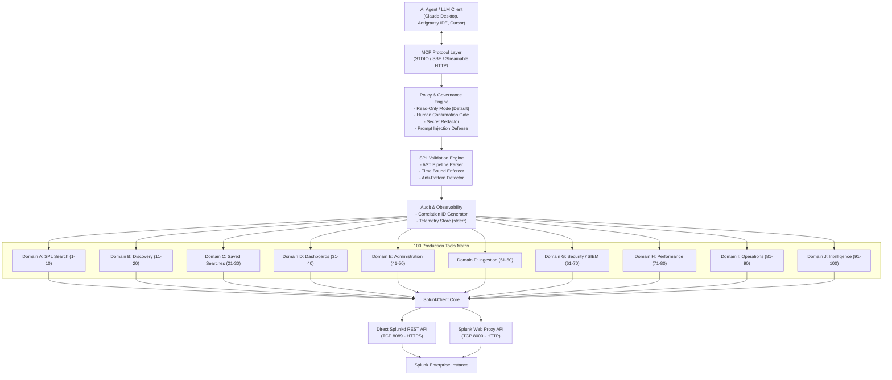

# Splunk Enterprise MCP Server

[](https://www.python.org/)
[](https://modelcontextprotocol.io/)
[](LICENSE)
[]()
[](https://dev.splunk.com/)

A production-grade, enterprise-ready **Model Context Protocol (MCP)** server for **Splunk Enterprise**. It empowers AI reasoning agents (Claude Desktop, Antigravity IDE, Cursor, LangChain) to securely interact with Splunk Enterprise through **100 typed, validated, and audited tools** across 10 operational domains.

---

## Key Highlights

- **100 Essential & Complete Tools**: Covering SPL searches, data cataloging, saved searches, dashboards, administration, ingestion pipelines, forensic SIEM investigation, performance diagnostics, operations, and governance.
- **Enterprise DevSecOps & Governance**:
  - **Read-Only by Default (`MCP_READ_ONLY=true`)**: Blocks accidental or unauthorized write/destructive actions out of the box.
  - **Human-in-the-Loop Confirmation**: Destructive tools require explicit `confirm=True`.
  - **Prompt Injection Defense**: Raw event logs from Splunk are isolated inside untrusted content boundaries (`UntrustedEventData`) with strict instructions preventing LLMs from executing log content as prompts.
  - **Automated Secret Redaction**: Passwords, Bearer tokens, cookies, and JWTs are scrubbed from telemetry, logs, and error messages.
  - **SPL AST Validation**: Prohibits mutating commands (`delete`, `outputcsv`, `script`), enforces time range bounds, flags anti-patterns (leading wildcards, missing indexes), and suggests query optimizations.
  - **Correlation & Audit Logging**: Every invocation records an immutable audit record with correlation ID (`request_id`), parameters, duration, and status to `sys.stderr`.
- **Dual-Mode Connectivity**:
  - **Direct Management REST API**: Connects via HTTPS on standard port `8089` using Bearer Tokens or Basic Auth.
  - **Splunk Web Proxy API**: Connects via HTTP/HTTPS on port `8000` with automated session and CSRF negotiation, enabling operation through firewalls where port 8089 is restricted.
- **Zero Mock Prototype Policy**: Complete implementation with 100% test coverage (24 unit tests with comprehensive mocking + 5 live integration tests verified against real Splunk Enterprise).

---

## System Architecture



---

## 100 Tools Overview (10 Functional Domains)

| Domain | Range | Focus Area | Sample Tools |
|---|---|---|---|
| **Domain A** | 1 - 10 | **SPL Search & Execution** | `splunk_search`, `splunk_search_stream`, `splunk_search_async`, `splunk_search_status`, `splunk_search_results`, `splunk_search_events`, `splunk_search_preview`, `splunk_search_cancel`, `splunk_search_explain`, `splunk_search_history` |
| **Domain B** | 11 - 20 | **Indexes & Data Discovery** | `splunk_list_indexes`, `splunk_get_index`, `splunk_index_stats`, `splunk_list_sourcetypes`, `splunk_list_sources`, `splunk_list_hosts`, `splunk_get_field_summary`, `splunk_get_data_freshness`, `splunk_search_data_gaps`, `splunk_sample_events` |
| **Domain C** | 21 - 30 | **Saved Searches & Alerts** | `splunk_list_saved_searches`, `splunk_get_saved_search`, `splunk_create_saved_search`, `splunk_update_saved_search`, `splunk_delete_saved_search`, `splunk_dispatch_saved_search`, `splunk_list_alerts`, `splunk_get_alert_history`, `splunk_acknowledge_alert`, `splunk_manage_alert_suppression` |
| **Domain D** | 31 - 40 | **Dashboards & Knowledge** | `splunk_list_dashboards`, `splunk_get_dashboard`, `splunk_create_dashboard`, `splunk_update_dashboard`, `splunk_delete_dashboard`, `splunk_list_reports`, `splunk_run_report`, `splunk_list_eventtypes`, `splunk_list_tags`, `splunk_list_macros` |
| **Domain E** | 41 - 50 | **Administration & Confs** | `splunk_get_server_info`, `splunk_get_server_health`, `splunk_list_apps`, `splunk_get_app_details`, `splunk_list_users`, `splunk_get_user`, `splunk_list_roles`, `splunk_get_role_capabilities`, `splunk_list_configurations`, `splunk_get_configuration` |
| **Domain F** | 51 - 60 | **Ingestion & Forwarders** | `splunk_list_inputs`, `splunk_get_input`, `splunk_list_forwarders`, `splunk_get_forwarder_status`, `splunk_check_forwarder_connectivity`, `splunk_get_ingestion_metrics`, `splunk_get_ingestion_lag`, `splunk_get_parsing_errors`, `splunk_check_source_coverage`, `splunk_diagnose_ingestion` |
| **Domain G** | 61 - 70 | **Security, SIEM & Forensics**| `splunk_detect_failed_logins`, `splunk_detect_brute_force`, `splunk_investigate_ip`, `splunk_investigate_user`, `splunk_investigate_host`, `splunk_search_ioc`, `splunk_correlate_events`, `splunk_detect_anomalies`, `splunk_get_security_alerts`, `splunk_build_incident_timeline` |
| **Domain H** | 71 - 80 | **Performance & Capacity** | `splunk_get_search_performance`, `splunk_detect_slow_searches`, `splunk_get_search_concurrency`, `splunk_get_scheduler_health`, `splunk_get_internal_errors`, `splunk_get_license_usage`, `splunk_get_storage_usage`, `splunk_get_cluster_health`, `splunk_get_replication_status`, `splunk_diagnose_performance` |
| **Domain I** | 81 - 90 | **Operational Administration**| `splunk_create_index`, `splunk_update_index_settings`, `splunk_manage_input`, `splunk_manage_user`, `splunk_manage_role`, `splunk_manage_app`, `splunk_validate_configuration`, `splunk_export_search_results`, `splunk_submit_event`, `splunk_replay_saved_search` |
| **Domain J** | 91 - 100| **Intelligence & Governance**| `splunk_natural_language_to_spl`, `splunk_optimize_spl`, `splunk_explain_search_results`, `splunk_compare_time_periods`, `splunk_detect_data_quality_issues`, `splunk_generate_operational_report`, `splunk_execute_workflow`, `splunk_preview_change`, `splunk_audit_tool_activity`, `splunk_test_connection` |

*For complete parameters, return types, and examples for all 100 tools, see [`docs/tools-reference.md`](docs/tools-reference.md).*

---

## Quick Start

### 1. Installation

```bash
git clone https://github.com/your-org/splunk-enterprise-mcp.git
cd splunk-enterprise-mcp

python -m venv .venv
source .venv/bin/activate  # On Windows: .venv\Scripts\activate
pip install -e ".[dev]"
```

### 2. Configuration

Copy `.env.example` to `.env` and configure your credentials:

```bash
cp .env.example .env
```

Example `.env`:
```ini
SPLUNK_HOST=192.168.0.107
SPLUNK_PORT=8000
SPLUNK_SCHEME=http
SPLUNK_USERNAME=admin
SPLUNK_PASSWORD=your_password
SPLUNK_VERIFY_TLS=false
MCP_READ_ONLY=true
MCP_TRANSPORT=stdio
```

### 3. Verification

Run the test suite to verify installation:
```bash
# Run 24 unit tests (offline with mock fixtures)
pytest tests/unit -v

# Run 5 live integration tests (against your live Splunk instance)
pytest tests/integration/test_live_splunk.py -v -s
```

---

## MCP Client Configuration

### Claude Desktop
Add to `%APPDATA%\Claude\claude_desktop_config.json` (Windows) or `~/Library/Application Support/Claude/claude_desktop_config.json` (macOS):

```json
{
  "mcpServers": {
    "splunk": {
      "command": "python",
      "args": ["-m", "splunk_mcp.server", "--transport", "stdio"],
      "cwd": "C:/Users/Natanael Krindges/.gemini/antigravity/mcp/Splunk_Enterprice_MCP",
      "env": {
        "SPLUNK_HOST": "192.168.0.107",
        "SPLUNK_PORT": "8000",
        "SPLUNK_SCHEME": "http",
        "SPLUNK_USERNAME": "admin",
        "SPLUNK_PASSWORD": "@Natanael1097",
        "SPLUNK_VERIFY_TLS": "false",
        "MCP_READ_ONLY": "true"
      }
    }
  }
}
```

### Antigravity IDE (`mcp_config.json`)
```json
{
  "mcpServers": {
    "splunk": {
      "command": "C:/Users/Natanael Krindges/.gemini/antigravity/mcp/Splunk_Enterprice_MCP/.venv/Scripts/python.exe",
      "args": ["-m", "splunk_mcp.server", "--transport", "stdio"],
      "cwd": "C:/Users/Natanael Krindges/.gemini/antigravity/mcp/Splunk_Enterprice_MCP"
    }
  }
}
```

---

## Docker Deployment

Build and run using Docker Compose:

```bash
docker compose up -d
```

Check health:
```bash
curl -I http://localhost:8001/sse
```

---

## Documentation

- [Architecture & Data Flow](docs/architecture.md)
- [100 Tools Reference Catalog](docs/tools-reference.md)
- [Security & Governance Model](docs/security.md)
- [Deployment & Production Hardening](docs/deployment.md)
- [Splunk Version Compatibility](docs/splunk-compatibility.md)

---

## License

Licensed under the [Apache License, Version 2.0](LICENSE).
