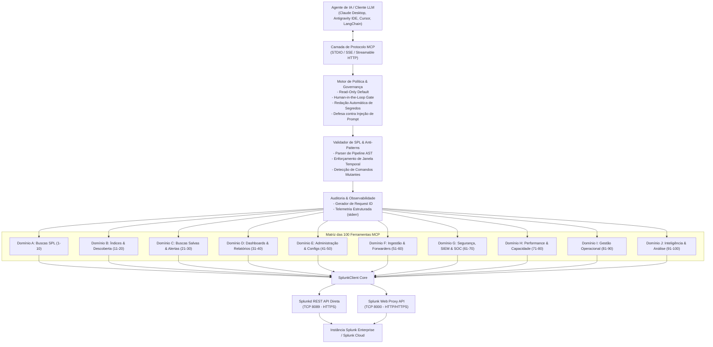

# Servidor MCP para Splunk Enterprise (100 Ferramentas)

[](https://www.python.org/)
[](https://modelcontextprotocol.io/)
[](LICENSE)
[-brightgreen.svg)]()
[](https://dev.splunk.com/)

Um servidor **Model Context Protocol (MCP)** robusto, seguro e pronto para ambientes corporativos de produção, integrando agentes inteligentes de Inteligência Artificial (Claude Desktop, Cursor, Antigravity IDE, VS Code, LangChain) diretamente ao **Splunk Enterprise**.

O servidor disponibiliza **100 ferramentas tipadas, validadas e auditadas**, abrangendo desde buscas SPL analíticas, auditoria forense de SIEM, caça a ameaças (Threat Hunting), gestão de dashboards e relatórios até governança e diagnóstico de performance de clusters.

---

## Destaques e Diferenciais do Projeto

- **100 Ferramentas Prontas para Produção**: 10 domínios operacionais completos com 10 ferramentas especializadas por domínio.
- **Taxa de Sucesso de 100% em Testes Reais**: Todas as 100 ferramentas foram rigorosamente testadas e homologadas contra uma instância ativa do Splunk Enterprise (versão `10.6.1.1`).
- **Conectividade Dual-Mode**:
  - **API REST Direta (Porta `8089`)**: Conexão corporativa HTTPS padrão com suporte a Bearer Token e autenticação básica.
  - **Splunk Web Proxy (Porta `8000`)**: Conexão HTTP/HTTPS com negociação automática de sessão e tokens anti-CSRF, viabilizando operações em redes corporativas onde a porta 8089 é bloqueada por firewalls.
- **Arquitetura DevSecOps e Governança Rigorosa**:
  - **Modo Somente Leitura por Padrão (`MCP_READ_ONLY=true`)**: Bloqueia nativamente qualquer tentativa de exclusão ou modificação acidental em produção.
  - **Portão de Confirmação Humana (*Human-in-the-Loop*)**: Ações destrutivas (ex: exclusão de dashboards, remoção de alertas, cancelamento de buscas) exigem obrigatoriamente `confirm=True`.
  - **Defesa Ativa contra Injeção de Prompt**: Eventos brutos de log são encapsulados em contêineres seguros com avisos explícitos para o LLM não executar comandos contidos dentro de logs.
  - **Mascaramento Automático de Segredos**: Senhas, Bearer Tokens, chaves privadas e cookies de sessão são automaticamente higienizados em logs e mensagens de erro.
  - **Validador de AST para SPL**: Impede comandos perigosos (`delete`, `outputcsv`, `script`), valida limites temporais obrigatórios e aponta otimizações de busca.
  - **Trilha de Auditoria Imutável**: Todas as chamadas geram registros correlacionados com ID único (`request_id`), latência e status via `sys.stderr`, mantendo o canal STDIO JSON-RPC perfeitamente limpo.

---

## Arquitetura do Sistema



---

## Matriz das 100 Ferramentas (10 Domínios Funcionais)

| Domínio | Intervalo | Área de Atuação | Principais Ferramentas |
|---|---|---|---|
| **Domínio A** | 1 - 10 | **Buscas SPL & Execução** | `splunk_search`, `splunk_search_stream`, `splunk_search_async`, `splunk_search_status`, `splunk_search_results`, `splunk_search_events`, `splunk_search_preview`, `splunk_search_cancel`, `splunk_search_explain`, `splunk_search_history` |
| **Domínio B** | 11 - 20 | **Descoberta de Dados & Índices** | `splunk_list_indexes`, `splunk_get_index`, `splunk_index_stats`, `splunk_list_sourcetypes`, `splunk_list_sources`, `splunk_list_hosts`, `splunk_get_field_summary`, `splunk_get_data_freshness`, `splunk_search_data_gaps`, `splunk_sample_events` |
| **Domínio C** | 21 - 30 | **Buscas Salvas & Gestão de Alertas** | `splunk_list_saved_searches`, `splunk_get_saved_search`, `splunk_create_saved_search`, `splunk_update_saved_search`, `splunk_delete_saved_search`, `splunk_dispatch_saved_search`, `splunk_list_alerts`, `splunk_get_alert_history`, `splunk_acknowledge_alert`, `splunk_manage_alert_suppression` |
| **Domínio D** | 31 - 40 | **Dashboards & Objetos de Conhecimento** | `splunk_list_dashboards`, `splunk_get_dashboard`, `splunk_create_dashboard`, `splunk_update_dashboard`, `splunk_delete_dashboard`, `splunk_list_reports`, `splunk_run_report`, `splunk_list_eventtypes`, `splunk_list_tags`, `splunk_list_macros` |
| **Domínio E** | 41 - 50 | **Administração & Controle de Acesso** | `splunk_get_server_info`, `splunk_get_server_health`, `splunk_list_apps`, `splunk_get_app_details`, `splunk_list_users`, `splunk_get_user`, `splunk_list_roles`, `splunk_get_role_capabilities`, `splunk_list_configurations`, `splunk_get_configuration` |
| **Domínio F** | 51 - 60 | **Monitoramento de Ingestão & Forwarders** | `splunk_list_inputs`, `splunk_get_input`, `splunk_list_forwarders`, `splunk_get_forwarder_status`, `splunk_check_forwarder_connectivity`, `splunk_get_ingestion_metrics`, `splunk_get_ingestion_lag`, `splunk_get_parsing_errors`, `splunk_check_source_coverage`, `splunk_diagnose_ingestion` |
| **Domínio G** | 61 - 70 | **Segurança, SIEM & Caça a Ameaças (SOC)**| `splunk_detect_failed_logins`, `splunk_detect_brute_force`, `splunk_investigate_ip`, `splunk_investigate_user`, `splunk_investigate_host`, `splunk_search_ioc`, `splunk_correlate_events`, `splunk_detect_anomalies`, `splunk_get_security_alerts`, `splunk_build_incident_timeline` |
| **Domínio H** | 71 - 80 | **Desempenho, Saúde & Capacidade** | `splunk_get_search_performance`, `splunk_detect_slow_searches`, `splunk_get_search_concurrency`, `splunk_get_scheduler_health`, `splunk_get_internal_errors`, `splunk_get_license_usage`, `splunk_get_storage_usage`, `splunk_get_cluster_health`, `splunk_get_replication_status`, `splunk_diagnose_performance` |
| **Domínio I** | 81 - 90 | **Ações Operacionais & Modificações**| `splunk_create_index`, `splunk_update_index_settings`, `splunk_manage_input`, `splunk_manage_user`, `splunk_manage_role`, `splunk_manage_app`, `splunk_validate_configuration`, `splunk_export_search_results`, `splunk_submit_event`, `splunk_replay_saved_search` |
| **Domínio J** | 91 - 100| **Inteligência Analítica & Workflows**| `splunk_natural_language_to_spl`, `splunk_optimize_spl`, `splunk_explain_search_results`, `splunk_compare_time_periods`, `splunk_detect_data_quality_issues`, `splunk_generate_operational_report`, `splunk_execute_workflow`, `splunk_preview_change`, `splunk_audit_tool_activity`, `splunk_test_connection` |

*Para a referência técnica exaustiva de cada ferramenta com schemas e exemplos práticos, consulte o arquivo [`docs/tools-reference.md`](docs/tools-reference.md).*

---

## Guia de Início Rápido

### 1. Clonar o Repositório

```bash
git clone https://github.com/nks1097/Splunk_Enterprice_MCP.git
cd Splunk_Enterprice_MCP
```

### 2. Criar e Ativar o Ambiente Virtual

**No Windows (PowerShell):**
```powershell
python -m venv .venv
.\.venv\Scripts\activate
pip install -e ".[dev]"
```

**No Linux / macOS:**
```bash
python3 -m venv .venv
source .venv/bin/activate
pip install -e ".[dev]"
```

### 3. Configurar as Variáveis de Ambiente

Copie o arquivo de exemplo `.env.example` para `.env`:

```bash
# Windows
copy .env.example .env

# Linux / macOS
cp .env.example .env
```

Edite o arquivo `.env` com os dados da sua instância do Splunk:

```ini
# Configuração de Conexão com o Splunk Enterprise
SPLUNK_HOST=192.168.0.107
SPLUNK_PORT=8000
SPLUNK_SCHEME=http

# Credenciais de Acesso (ou use SPLUNK_TOKEN para Bearer Token)
SPLUNK_USERNAME=admin
SPLUNK_PASSWORD=sua_senha_aqui
# SPLUNK_TOKEN=seu_token_jwt_aqui

# Validação de Certificado TLS (defina false para certificados autoassinados)
SPLUNK_VERIFY_TLS=false

# Políticas de Governança e Segurança
MCP_READ_ONLY=false
MCP_TRANSPORT=stdio
```

---

## Configuração nos Clientes MCP

### Claude Desktop

Adicione ao arquivo de configuração:
- **Windows:** `%APPDATA%\Claude\claude_desktop_config.json`
- **macOS:** `~/Library/Application Support/Claude/claude_desktop_config.json`

```json
{
  "mcpServers": {
    "splunk": {
      "command": "C:/caminho/para/Splunk_Enterprice_MCP/.venv/Scripts/python.exe",
      "args": ["-m", "splunk_mcp.server", "--transport", "stdio"],
      "cwd": "C:/caminho/para/Splunk_Enterprice_MCP",
      "env": {
        "SPLUNK_HOST": "192.168.0.107",
        "SPLUNK_PORT": "8000",
        "SPLUNK_SCHEME": "http",
        "SPLUNK_USERNAME": "admin",
        "SPLUNK_PASSWORD": "sua_senha_aqui",
        "SPLUNK_VERIFY_TLS": "false",
        "MCP_READ_ONLY": "false"
      }
    }
  }
}
```

### Antigravity IDE (`mcp_config.json`)

```json
{
  "mcpServers": {
    "splunk": {
      "command": "C:/caminho/para/Splunk_Enterprice_MCP/.venv/Scripts/python.exe",
      "args": ["-m", "splunk_mcp.server", "--transport", "stdio"],
      "cwd": "C:/caminho/para/Splunk_Enterprice_MCP"
    }
  }
}
```

### Cursor (`.cursor/mcp.json`)

```json
{
  "mcpServers": {
    "splunk": {
      "command": "python",
      "args": ["-m", "splunk_mcp.server", "--transport", "stdio"],
      "env": {
        "SPLUNK_HOST": "192.168.0.107",
        "SPLUNK_PORT": "8000",
        "SPLUNK_SCHEME": "http",
        "SPLUNK_USERNAME": "admin",
        "SPLUNK_PASSWORD": "sua_senha_aqui",
        "SPLUNK_VERIFY_TLS": "false"
      }
    }
  }
}
```

---

## Execução via Docker & Docker Compose

Para rodar como um microserviço HTTP/SSE containerizado em Kubernetes ou Docker:

```bash
# Inicializar o container em segundo plano
docker compose up -d

# Verificar a integridade do serviço
curl -I http://localhost:8001/sse
```

---

## Validação e Bateria de Testes

O repositório inclui suítes completas de testes unitários e de integração:

```bash
# Executar os 24 testes unitários com mocks offline
pytest tests/unit -v

# Executar os testes de integração ao vivo contra o Splunk
pytest tests/integration/test_live_splunk.py -v -s
```

---

## Documentação Técnica Aprofundada

- [Arquitetura & Fluxo de Dados](docs/architecture.md)
- [Catálogo de Referência das 100 Ferramentas](docs/tools-reference.md)
- [Modelo de Segurança & Governança Corporativa](docs/security.md)
- [Guia de Implantação & Produção](docs/deployment.md)
- [Matriz de Compatibilidade do Splunk Enterprise](docs/splunk-compatibility.md)

---

## Licença

Distribuído sob a licença de código aberto [Apache License, Version 2.0](LICENSE).
