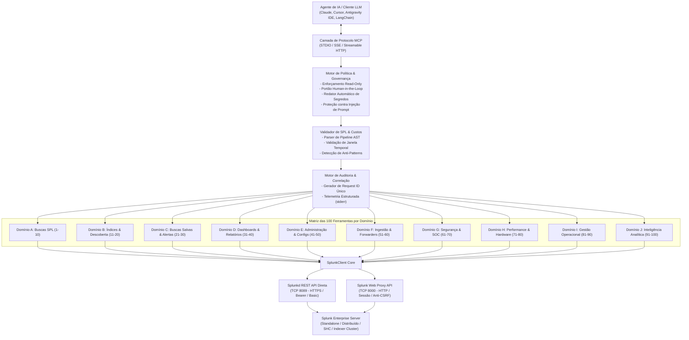

# Arquitetura do Servidor MCP para Splunk Enterprise

## 1. Visão Geral do Sistema

O **Servidor Model Context Protocol (MCP) para Splunk Enterprise** estabelece uma ponte bidirecional entre Agentes Inteligentes de Inteligência Artificial (LLMs) e instâncias do Splunk Enterprise, oferecendo interfaces seguras, tipadas, auditadas e tolerantes a falhas.

---

## 2. Camadas Arquiteturais Detalhadas

### 1. Camada de Protocolo e Transporte (`mcp.server.mcpserver`)
- **Transporte STDIO (Standard I/O)**: Ideal para integração local com IDEs de desenvolvimento de IA (Claude Desktop, Cursor, Antigravity IDE, Roo Code, Cline). Toda a comunicação JSON-RPC trafega por `sys.stdout`.
- **Isolamento Estrito de Diagnósticos**: Logs internos de depuração, advertências e telemetria são emitidos exclusivamente via `sys.stderr`, garantindo que o canal de dados JSON-RPC permaneça 100% íntegro e sem poluição.
- **Transportes de Rede (SSE & Streamable HTTP)**: Suporte para exposição como microserviço HTTP em contêineres Docker e orquestradores Kubernetes.

### 2. Camada de Governança, Política e Segurança
- **Modo Somente Leitura (`MCP_READ_ONLY=true`)**: Ativado por padrão para proteger ambientes produtivos contra modificações acidentais de índices, papéis de usuário ou dashboards.
- **Portão de Confirmação Humana (*Human-in-the-Loop*)**: Ferramentas com potencial destrutivo (como `splunk_search_cancel`, `splunk_delete_saved_search`, `splunk_delete_dashboard` e remoção de usuários) exigem explicitamente o parâmetro `confirm=True`. Sem isso, uma resposta preventiva com detalhes da ação pretendida é devolvida para validação do operador humano.
- **Defesa Ativa contra Injeção de Prompt**: Logs recuperados de sistemas externos podem conter instruções maliciosas injetadas por invasores. O servidor encapsula esses registros no container `UntrustedEventData`, acompanhado de cabeçalhos de segurança obrigatórios para o modelo de linguagem.
- **Redator Automático de Segredos**: Higieniza automaticamente tokens Bearer, senhas, chaves privadas e cookies de sessão (`splunkd_*`) antes de devolver qualquer resposta ou registrar logs de auditoria.

### 3. Validador de SPL e Otimizador de Consultas (`SPLValidator`)
- **Decomposição em AST (Árvore Sintática Abstrata)**: Processa e decompõe cada estágio do pipeline SPL (`search`, `stats`, `eval`, `dedup`, `table`, etc.).
- **Bloqueio de Comandos Perigosos**: Impede a execução de comandos capazes de apagar dados ou gravar artefatos arbitrários (`delete`, `outputcsv`, `outputlookup`, `script`).
- **Verificação de Limites Temporais**: Garante a presença de cláusulas `earliest` e `latest`, prevenindo buscas irrestritas que consumiriam memória excessiva no cluster de indexadores.
- **Detecção de Anti-Patterns**: Alerta sobre wildcards no início de strings (`*termo`) ou ausência de filtro de índice (`index=`).

### 4. Cliente Splunk Multi-Conexão (`SplunkClient`)
- **Modo Direto (Porta 8089 - HTTPS)**: Comunicação direta com a API REST do daemon `splunkd`.
- **Modo Web Proxy (Porta 8000 - HTTP/HTTPS)**: Negocia automaticamente autenticação de sessão via cookies e tokens CSRF (`splunkweb_csrf_token_8000`), viabilizando a integração mesmo em redes restritas onde a porta de gerenciamento padrão está bloqueada.
