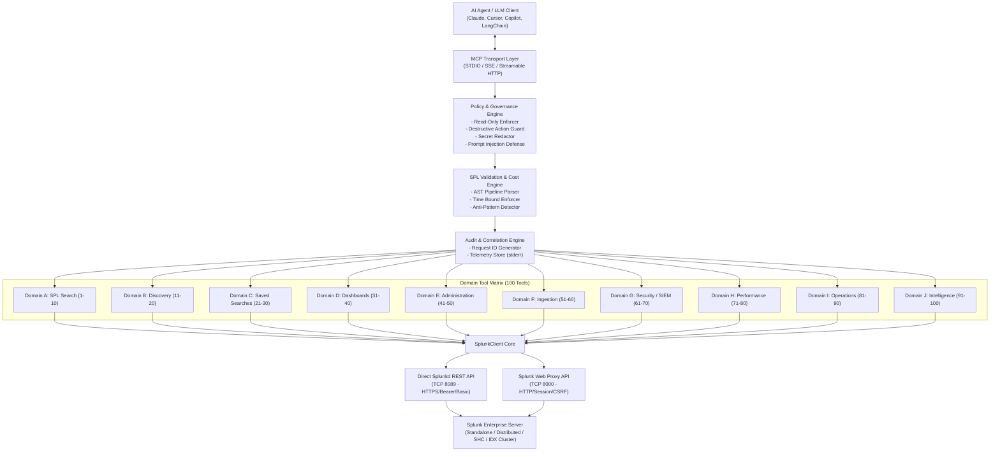

# Splunk Enterprise MCP Server Architecture

## 1. System Overview

The **Splunk Enterprise Model Context Protocol (MCP) Server** bridges Large Language Model (LLM) reasoning agents with Splunk Enterprise through typed, secure, audited, and resilient interfaces.

## 2. Layered Architecture

1. **Protocol & Transport Layer (`mcp.server.mcpserver`)**:
   - Supports Standard I/O (`stdio`) for local desktop IDE agents (e.g. Claude Desktop, VS Code, Antigravity IDE).
   - Supports Server-Sent Events (`sse`) and Streamable HTTP (`streamable-http`) for microservices and Kubernetes deployments.
   - Strictly redirects all operational diagnostics to `sys.stderr` so the JSON-RPC STDIO pipe on `sys.stdout` remains pristine.

2. **Policy, Governance, and Security Guard**:
   - **Read-Only Mode (`MCP_READ_ONLY=true`)**: Activated by default. Blocks mutating actions (index creation, app toggling, user removal, query deletion) unless explicitly overridden by enterprise policy.
   - **Human Confirmation Gate**: High-impact destructive tools require explicit `confirm=True`. If omitted, the server returns an explanatory confirmation warning with the target resource details.
   - **Secret Redaction**: Recursively strips passwords, Bearer tokens, Splunk session cookies (`splunkd_*`), and JWT signatures from error messages, debug logs, and tool payloads.
   - **Prompt Injection Defense**: Encapsulates raw log records in `UntrustedEventData` boundaries with strict system advisories warning LLMs not to interpret log lines as executable instructions.

3. **SPL Validation & Cost Engine (`SPLValidator`)**:
   - Parses the command pipeline (`search`, `stats`, `dedup`, `eval`, `sort`, `join`).
   - Rejects mutating commands (`delete`, `outputcsv`, `outputlookup`, `script`, `run`) during read-only operation.
   - Flags anti-patterns (leading wildcards `*term`, missing `index=` filter, expensive joins).
   - Suggests optimized query structures.

4. **Dual-Mode Splunk Connectivity Client (`SplunkClient`)**:
   - **Direct Management REST API**: Connects via HTTPS on standard port `8089` using Bearer Tokens or Basic Authentication.
   - **Splunk Web Proxy API**: Connects via HTTP/HTTPS on port `8000` (`/en-US/splunkd/__raw/services/*`) with automated cookie and CSRF token negotiation (`splunkweb_csrf_token_8000`, `splunkd_8000`), allowing operations even in environments where port 8089 is firewall-blocked.
